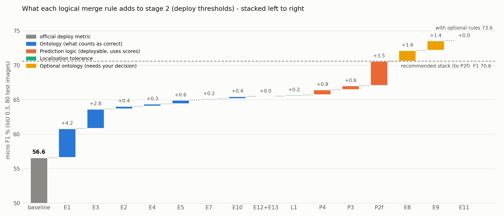
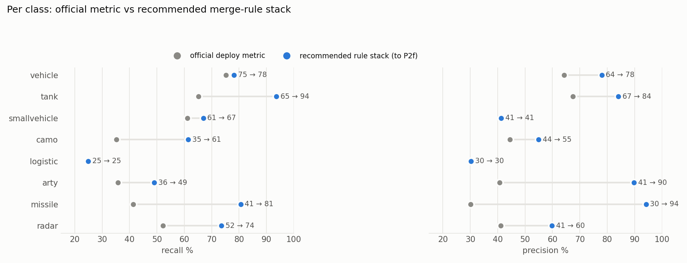

# Attribute patterns × stage-2 predictions → logical merge rules (next evolution)

Built 2026-10-12 · oct_w3/n0001 · model = sep_w1 FINAL ensemble (stage 2) at the **deployment thresholds** · 80 test images · IoU 0.3.

## Headline

| | precision % | recall % | F1 % | macro P % | macro R % |
|---|--:|--:|--:|--:|--:|
| official deploy metric (strict, simple mapping) | 53.6 | 60.0 | **56.6** | 45.0 | 48.9 |
| + all recommended ontology rules (E1–E13, L1) | 62.4 | 69.4 | **65.7** | 56.2 | 61.4 |
| + prediction logic P4, P3, P2f = **recommended stack** | 67.0 | 74.6 | **70.6** | 66.5 | 66.0 |
| + optional E8, E9, E11 | 69.8 | 77.7 | **73.6** | 68.9 | 70.4 |

Deployable gains on the **unchanged official GT** (no ontology relaxation):

| | P % | R % | F1 % | macro P % | macro R % | TP |
|---|--:|--:|--:|--:|--:|--:|
| baseline | 53.6 | 60.0 | 56.6 | 45.0 | 48.9 | 3059 |
| +P4 (strict GT) | 54.1 | 60.5 | 57.1 | 47.1 | 48.9 | 3087 |
| +P4+P3 (strict GT) | 54.8 | 61.3 | 57.9 | 47.3 | 51.9 | 3126 |
| +P4+P3+P2f (strict GT) | 60.2 | 67.3 | 63.5 | 55.4 | 56.5 | 3433 |

## The merge chart — every rule, what it does, what it buys

`alone` = TP gained by the rule on its own (E/L/P on top of E1; P4 strict). `stacked` = TP gained in the waterfall order. F1 = micro F1 after the step.

| rule | family | logic | evidence from the predictions | alone ΔTP | stacked ΔTP | F1 after | deployable | status |
|---|---|---|---|--:|--:|--:|---|---|
| **E1** | Ontology | Camouflaged object (labels_detailed `camo`, or P_Camo=Yes) is correct if predicted `camo` **or** its hardware class (from the fine label). Counted in the hardware row. | Camouflaged ICV → tank 78 / camo 61; P_Camo missiles → missile 98 of 145 | 228 | +228 | 60.8 | eval only | agreed (n0002) |
| **E3** | Ontology | Fine label **ICV** accepts `tank` and `vehicle` (armoured infantry carrier). | ICV (559 tank + 195 camo): → vehicle 153, → tank 431. On ICV→vehicle boxes the tank score is 2nd in 55 %, median 0.69 | 153 | +153 | 63.7 | eval only | recommended |
| **E2** | Ontology | P_Camo radar/missile also accepts `vehicle` (partly-covered launcher reads as a truck). | P_Camo missile → vehicle 22 of 145 (MLRS 14 of 20) | 22 | +22 | 64.1 | eval only | your example — recommended |
| **E4** | Ontology | SPATracked / SPAWheeled / PCL181 / K9 accept `arty` or `tank` (self-propelled guns look like tanks). | SPATracked → tank 11 of 17 | 17 | +17 | 64.4 | eval only | recommended |
| **E5** | Ontology | Missile Transporter / Transloader / Dump and MLRS accept `vehicle` (truck-borne kit). | Transporter+Transloader → vehicle 12 of 21; MLRS → vehicle 19 of 28 | 46 | +30 | 65.0 | eval only | recommended |
| **E7** | Ontology | EWS (truck-mounted radar) accepts `vehicle`. | EWS → vehicle 10 of 16 | 10 | +10 | 65.1 | eval only | recommended |
| **E10** | Ontology | Air-defence family: radar ↔ missile accepted for each other. | missile → radar 11, radar → missile 9 | 20 | +20 | 65.5 | eval only | recommended (cf. july_w4 air-merge) |
| **E12+E13** | Ontology | `concealment` counts as camo; boxes on aerial/radome are neutral (not FP). | camo boxes on concealment 10; radar boxes on helicopters 5 | 5 | +5 | 65.5 | eval only | recommended |
| **L1** | Localisation | Camo matches use IoU ≥ 0.1 (camo nets are drawn loosely). | 47 camo boxes at IoU 0.1–0.3 on camo/concealment | 9 | +10 | 65.7 | eval only | recommended |
| **P4** | Prediction | `arty` box whose vehicle score ≥ 0.90 → relabel `vehicle` (swap, no 2nd label). | LTV → arty 33: vehicle score 0.998 but arty is a priority class; swap fixes 32, loses 2 real arty | 28 | +42 | 66.5 | **yes — ship it** | recommended |
| **P3** | Prediction | `vehicle` box with missile or radar score ≥ 0.15 also carries `missile`/`radar` as a 2nd label. | missile → vehicle 72: missile score 2nd in 54 % | 54 | +31 | 67.0 | yes (2nd label) | recommended — 363 boxes get 2 labels |
| **P2f** | Prediction | Pair-specific 2nd label: vehicle→tank ≥0.30, vehicle→smallvehicle ≥0.30, arty→vehicle ≥0.10, arty→tank ≥0.50, radar→camo ≥0.30, camo→tank ≥0.10, missile→vehicle ≥0.20. | round-3 pair table (pair_thresholds.tsv): each pair's 2nd label is right 22–56 % of the time | 352 | +192 | 70.6 | yes (2nd label) | recommended as an 'alternative' field — 1145 boxes get 2 labels |
| **E8** | Optional | logistic ↔ TransportVehicle accepted for each other (both are trucks). | logistic → vehicle 58; TransportVehicle → logistic 26 | 84 | +85 | 72.2 | eval only | **your decision** |
| **E9** | Optional | smallvehicle accepts `vehicle` (size boundary). | smallvehicle → vehicle 124 | 124 | +76 | 73.6 | eval only | **your decision** |
| **E11** | Optional | LTV accepts `arty`. | covered by P4 once P4 is on (+0) | 36 | +0 | 73.6 | eval only | not needed if P4 |

Rules tested and **rejected**: E6 (Support-functionality hardware accepts missile/radar) +0 — the model already calls it vehicle;
P1/P1b (score-based override of the priority rule) +9/+27 but P1b lowers radar/missile recall — P4 does the useful part cleanly;
P2 blanket top-2 (any 2nd class ≥0.30) — +319 TP but **43 % of boxes** get a 2nd label: that is top-2 evaluation, not logic.

## Per class — official vs recommended stack

Recommended-stack rows count camouflaged objects under their hardware class (E1), so the GT column changes.

| class | official GT | official P % | official R % | stack GT | stack P % | stack R % | stack F1 % |
|---|--:|--:|--:|--:|--:|--:|--:|
| radar | 176 | 41.1 | 52.3 | 208 | 59.8 | 73.6 | 66.0 |
| missile | 162 | 30.2 | 41.4 | 319 | 94.1 | 80.6 | 86.8 |
| arty | 179 | 40.8 | 35.8 | 245 | 89.7 | 49.0 | 63.4 |
| logistic | 241 | 30.3 | 24.9 | 241 | 30.3 | 24.9 | 27.3 |
| camo | 750 | 44.4 | 35.2 | 215 | 54.9 | 61.4 | 58.0 |
| smallvehicle | 822 | 41.3 | 61.1 | 822 | 41.3 | 66.9 | 51.1 |
| tank | 729 | 67.5 | 65.2 | 966 | 84.1 | 93.6 | 88.6 |
| vehicle | 2041 | 64.2 | 75.2 | 2103 | 78.0 | 78.1 | 78.1 |

## What the patterns say (rounds 1–3)

**1. Most errors are look-alike families, not random.** Of 2,041 official FN, 1,123 got a box of the wrong class. The wrong class is almost
always a physical neighbour: ICV↔tank↔vehicle, missile kit↔truck, SPA↔tank, logistic↔vehicle, smallvehicle↔vehicle, camo↔what is under it.
These are what the ontology rules (E) and the 2nd-label logic (P2f/P3) recover.

**2. The score vector carries the right answer.** When the argmax is wrong, the true class is usually 2nd: ICV→vehicle has tank 2nd in 55 %
(median 0.69); missile→vehicle has missile 2nd in 54 %; logistic→vehicle has logistic 2nd in 60 %. That is why value-based rules work.

**3. Some 'errors' are made by deployment, not the model.** LTV→arty (33) and ICV→arty (33): vehicle/tank is the model's top score, but
arty is a priority class and wins the region. P4 removes most of that with a score test.

**4. Not mergeable — detection gaps.** K9: no deploy box on 16/16 and no box ≥ 0.05 at all on 13/16 (best score 0.45).
Type59AA: 31/32 have no box at all. Arty/SPA ≥ 10 m long: 1 of 67 correct. Radome 0/17 and aircraft 0/149 never get a box (not trained).
Logic cannot fix these; they need data or a dedicated class. (HQ6 is different: 6 of 10 have a raw box, up to 0.94 — a threshold/class issue.)

**5. Not mergeable — difficulty strata** (all classes, % correct): Quality 02 54.5 vs 01 63.8 · Position Open 43.1 / Closed 61.1 ·
Is_Empty Yes 42.1 · Pléiades 50.5–50.7 vs WV02 63.8 · objects < 4 m 40.0. Use these to stratify reports, not to relabel.

**6. False positives are mostly background.** 1,261 of 1,513 unmatched deploy boxes overlap no object at all (smallvehicle 596, vehicle 305,
camo 176). Merging can't remove them; that needs thresholds or a background-aware stage.

## Caveats

- **2nd labels are not free.** With P3+P2f, 1472 of 5705 boxes (26 %) carry two labels. A box counts as a TP if either label
  is acceptable. Ship it as `class` + `alternative`, not as two detections.
- **Ontology rules change the yardstick.** E-rule gains are 'what an operator would accept', not a better model. Report them next to the strict number.
- Matching here = global score-ordered, best-IoU, one box ↔ one object (the baseline reproduces the official TP 3,059 exactly).
- Thresholds for P2f/P3 were read off this same test set. Treat them as hypotheses and confirm them on a held-out split before freezing.

## Files

| file | what |
|---|---|
| `instances.tsv` / `.pkl` | 5,308 test instances × 57 cols: all attributes, Parent Class, deploy match, 8-class score vector, per-class raw evidence |
| `deploy_unmatched.pkl` | the 1,513 deploy boxes on no GT, with what they overlap |
| `pair_thresholds.tsv` | round 3: every primary→2nd pair × threshold: emitted / fixes / harmless / noise |
| `round2.json`, `round4_stack.json` | per-rule and stacked results, per class |
| `rules.py` | the rule engine (`python rules.py E1 E3 P4 …` scores any combination) |
| `build_table.py`, `round2.py`, `round3_pairs.py`, `round4_stack.py`, `make_charts.py`, `write_report.py` | reproducible pipeline, env `/sfs/envs/tide` |
